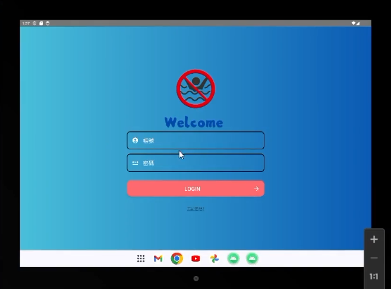
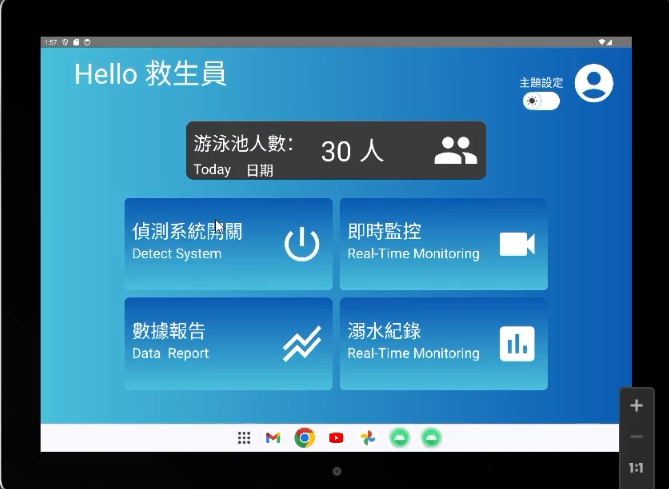
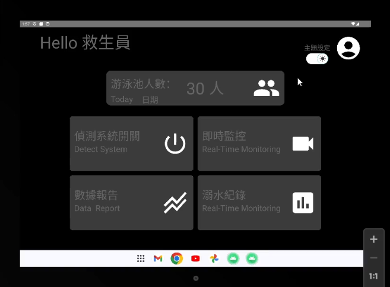
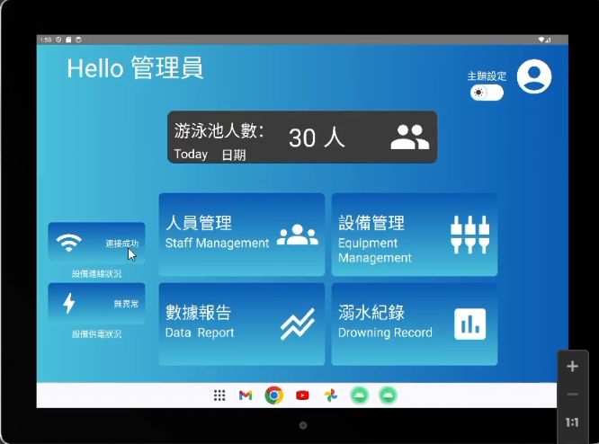
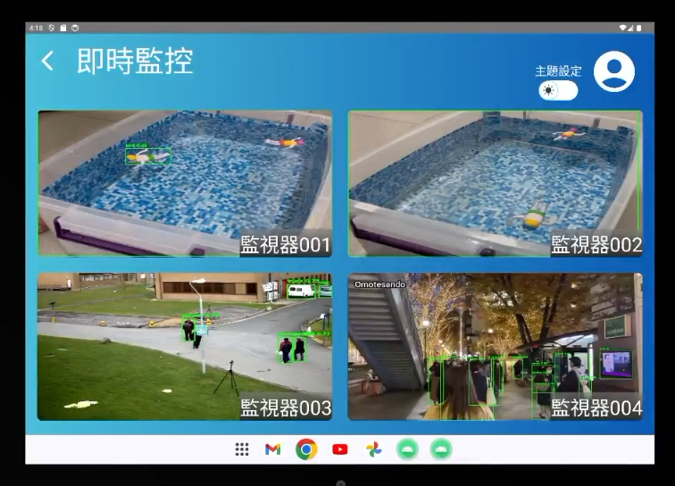
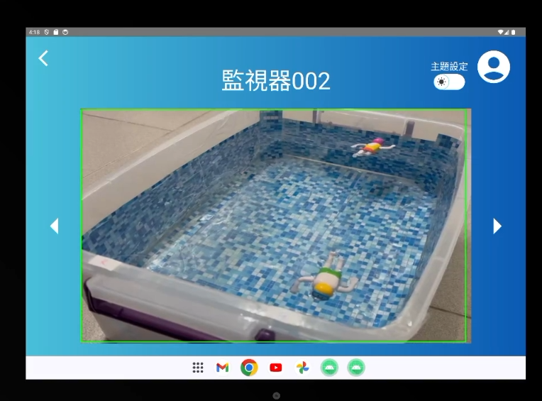
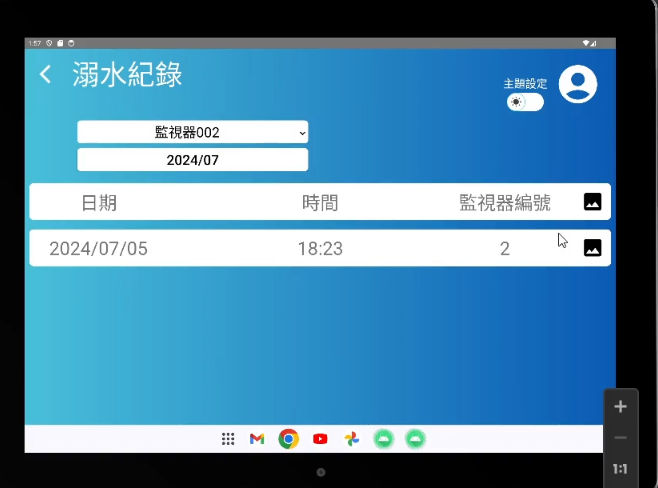
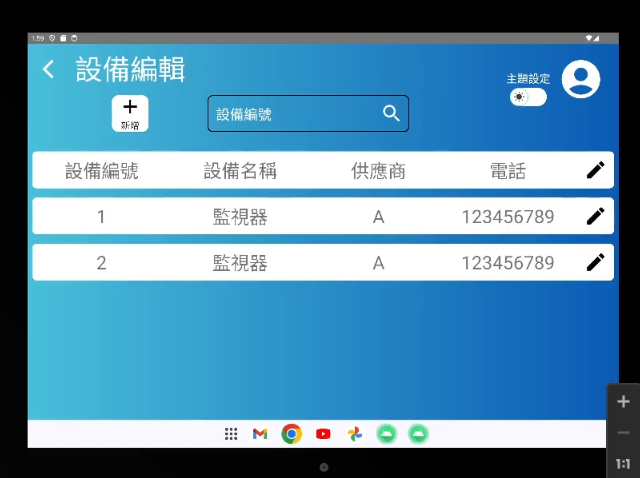
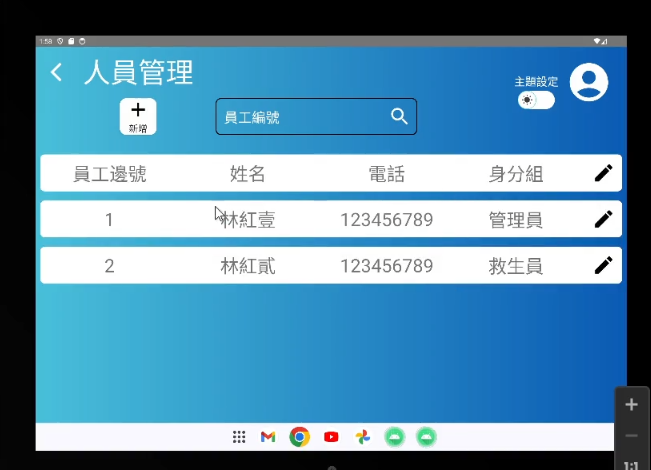
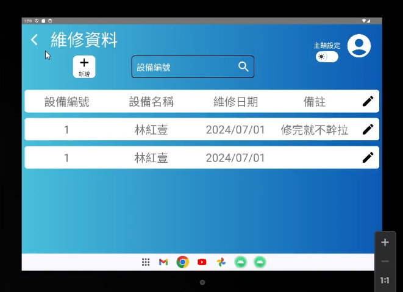

# 溺水偵測系統｜Android App
- 這是我為了大學專題溺水偵測系統所做的app，使用 Android App、 Kotlin 開發，結合了影像監控、警報系統、管理用途
- 以下為整個專題的介紹影片
> 本動畫用於介紹專題整體架構、攝影機配置及系統運作流程。動畫製作由我負責，內容涵蓋團隊共同開發的系統功能；本 Repository 則主要展示我獨立完成的 Android App

> **作品集展示版本**
>
> 本 Repository 主要用於展示 Android App 的程式碼、介面設計與實作成果，不以完整建置或直接執行為目標。為保護原始系統環境，部分 IP及設定資訊已替換為佔位文字。Google Apps Script 後端與 Google Sheets 資料不包含在本 Repository 中

---

## 專案展示

### App 操作畫面

| 登入畫面 | 員工首頁 |
|---|---|
|  | |

| 暗黑模式 | 管理員首頁 |
|---|---|
|  ||

| 監視器總覽 | 瀏覽單個監視器 |
|---|---|
|  |  |

| 警報紀錄 | 設備管理 |
|---|---|
|  |  |

| 人員管理 | 維修管理 |
|---|---|
|  |  |

### 操作影片
- 以Android Studio操作畫面做展示

---

## 專案功能

### 1. 使用者登入與首頁

- 提供登入入口，依使用者類型導向不同首
- 區分管理員與一般使用者的操作介面
- 首頁顯示系統相關資訊
- 支援深色模式設定

### 2. 即時監視器影像

- 使用 OkHttp 發送 HTTP 請求，接收攝影機 MJPEG 影像串流
- 支援四支攝影機影像同時顯示
- 解析 MJPEG 串流中的 JPEG Frames，並更新監視器畫面
- 提供個別影像放大檢視
- 支援不同攝影機之間的切換

### 3. 溺水警報紀錄

- 顯示系統產生的溺水警報紀錄
- 依攝影機及年月篩選紀錄
- 顯示警報日期、時間、攝影機編號及相關圖片
- 使用 RecyclerView 呈現警報資料

### 4. 設備管理

- 顯示設備資料列表
- 提供設備資料新增、修改及刪除功能
- 使用 RecyclerView 呈現設備資訊
- 透過資料 API 與後端進行資料交換

### 5. 人員管理

- 提供人員資料列表
- 支援人員資料新增、修改及刪除
- 使用 Adapter 管理列表資料與畫面更新

### 6. 維修資料管理

- 顯示設備維修紀錄
- 提供維修資料新增、修改及刪除
- 使用 RecyclerView 呈現維修資訊

### 7. 報表與系統資訊

- 使用 WebView 顯示系統報表網頁
- 透過 Google Apps Script Web App API 取得部分系統資料
- 使用 SharedPreferences 儲存深色模式及部分畫面設定

---
